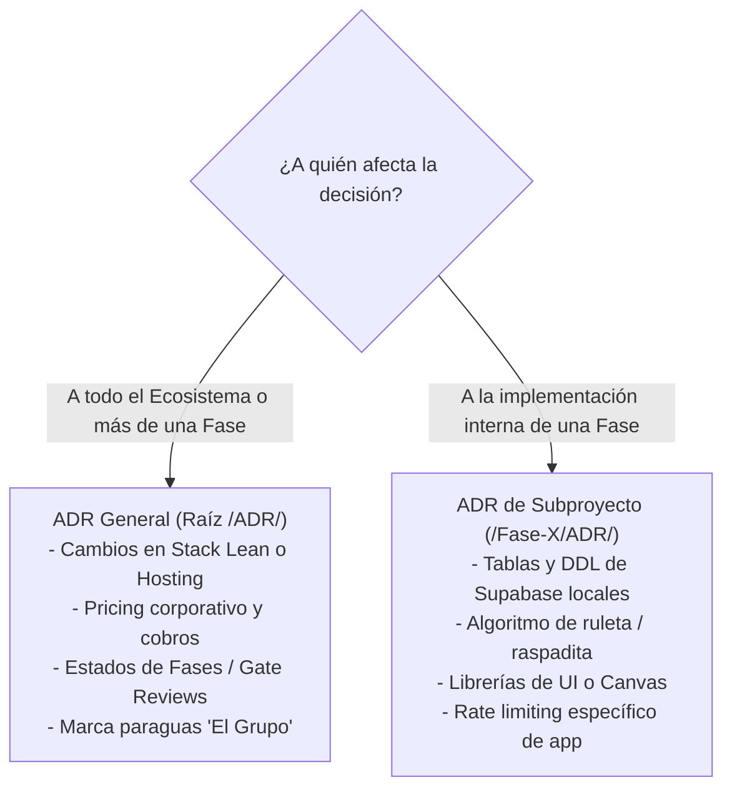

# Workflow: Creación y Actualización de ADRs

Este workflow define los pasos para formular, clasificar y registrar una decisión técnica o de negocio en los registros de arquitectura (ADRs) de 'El Grupo'.

---

## 🧭 Criterio de Decisión: ¿ADR General o ADR de Fase?



---

## 📋 Pasos para Registrar un ADR

### 1. Seleccionar la Ubicación
* **ADR General:** Carpeta [ADR/](file:///d:/Proyectos/GrupodeClouds/ADR/) en la raíz del proyecto.
* **Fase 1 (TuChance):** [Fase-1-ClienteReten/docs/03-tecnico/adr/](file:///d:/Proyectos/GrupodeClouds/Fase-1-ClienteReten/docs/03-tecnico/adr/).
* **Fase 1.5 (GrupoClouds):** [Fase-1.5-GrupoClouds/ADR/](file:///d:/Proyectos/GrupodeClouds/Fase-1.5-GrupoClouds/ADR/).
* **Fase 2 (CMS PyMEs):** [Fase-2-CMS-PyMEs/ADR/](file:///d:/Proyectos/GrupodeClouds/Fase-2-CMS-PyMEs/ADR/).
* **Fase 3 (CRM Modular):** [Fase-3-CRM-Modular/ADR/](file:///d:/Proyectos/GrupodeClouds/Fase-3-CRM-Modular/ADR/).
* **Fase 4 (Agencia Empleo):** [Fase-4-Agencia-Empleo/ADR/](file:///d:/Proyectos/GrupodeClouds/Fase-4-Agencia-Empleo/ADR/).
* **Fase 5 (Colchón Financiero):** [Fase-5-ColchonFinanciero/docs/03-tecnico/adr/](file:///d:/Proyectos/GrupodeClouds/Fase-5-ColchonFinanciero/docs/03-tecnico/adr/).

### 2. Determinar el Número Secuencial
Revisar el último ID registrado y asignar el siguiente con formato de cuatro dígitos (ejemplo: `0005-[slug-descriptivo].md`).

### 3. Redactar el Contenido con la Plantilla Oficial

```markdown
# ADR [Número]: [Título Breve y Conciso]

## Estado
[Propuesto | Aprobado | Rechazado | Obsoleto | Reemplazado por ADR-XXXX]

## Contexto
[Explicar el problema que se resuelve, limitaciones técnicas, restricciones presupuestarias o motivos comerciales.]

## Decisión
[Detallar con precisión la decisión adoptada, tecnología o patrón seleccionado.]

## Consecuencias
* **Impacto Positivo:** [Beneficios cuantitativos o cualitativos esperados]
* **Impacto Negativo / Trade-offs:** [Costos, complejidad o dependencias aceptadas]
* **Medidas de Mitigación:** [Cómo se gestionan y neutralizan los riesgos]
```

### 4. Actualizar el Índice de ADRs
Abrir el `README.md` del directorio de ADR intervenido e insertar la nueva fila en la tabla de decisiones con enlace directo al archivo.
