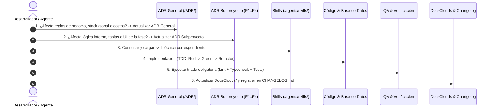

# Workflow: Ciclo de Desarrollo del Ecosistema 'El Grupo'

Este workflow define el procedimiento estándar obligatorio para cualquier cambio, nueva funcionalidad, refactor o integración en el ecosistema.

---

## 🧭 Diagrama de Secuencia del Flujo



---

## 📋 Pasos de Ejecución

### Paso 0: Preparación de Rama Git (`dev` como Base Obligatoria)
Antes de tocar cualquier archivo en un subproyecto con repositorio Git (`Fase-1-TuChance`, `Fase-1.5-GrupoClouds`, `Fase-5-ColchonFinanciero`, etc.):
1. Verificar que el working tree esté limpio (`git status --porcelain`).
2. Cambiar a la rama base **`dev`** y actualizarla:
   ```bash
   git fetch origin
   git switch dev
   git pull --ff-only origin dev
   ```
3. Crear una rama específica para el cambio partiendo desde `dev`:
   ```bash
   git switch -c feat/<nombre-del-cambio> # o fix/<nombre>, chore/<nombre>
   ```
4. **Regla inquebrantable:** Nunca desarrollar directamente sobre `main` ni `master`. Todo push o merge hacia `main` / `master` dispara el pipeline de CI/CD y despliega automáticamente en producción.

---

### Paso 1: Clasificación del Alcance del Cambio
Analizar la naturaleza del requerimiento:
* **¿Impacto Global / Ecosistema?**
  - Modificación del Stack Lean global o proveedores cloud (Vercel, Supabase, dominios).
  - Cambios en el modelo de pricing ($20.000 ARS/mes) o cobro (Mercado Pago, CVU).
  - Nuevas fases o cambios de estado de compuertas (Gate Reviews, descongelamiento de Fase 4).
  - Identidad o directrices corporativas paraguas de 'El Grupo'.
  ➔ **Acción:** Requiere actualizar primero el [ADR General](file:///d:/Proyectos/GrupodeClouds/ADR/).
* **¿Impacto Local del Subproyecto / Fase?**
  - Nueva tabla, columna o trigger en la base de datos de una fase.
  - Modificación del algoritmo antifraude o límites de participación de ClienteReten.
  - Adopción de librería de interfaz (ej. Canvas vs SVG para ruleta o raspadita).
  - Nuevos endpoints o contratos de API interna entre apps y packages.
  ➔ **Acción:** Requiere actualizar el [ADR Local de la Fase](file:///d:/Proyectos/GrupodeClouds/ClienteReten/docs/03-tecnico/adr/).

---

### Paso 2: Registro en ADR General (si aplica)
1. Abrir el directorio [/ADR/](file:///d:/Proyectos/GrupodeClouds/ADR/).
2. Crear o versionar el archivo `ADR/000X-[nombre-descriptivo].md` siguiendo la plantilla estándar:
   - **Estado:** Propuesto / Aprobado.
   - **Contexto:** Problema, costo o necesidad estratégica.
   - **Decisión:** Tecnología, política o arquitectura elegida.
   - **Consecuencias:** Impacto positivo, trade-offs y medidas de mitigación.
3. Actualizar la tabla índice en [ADR/README.md](file:///d:/Proyectos/GrupodeClouds/ADR/README.md).

---

### Paso 3: Registro en ADR de Subproyecto (ej. Fase 1)
1. Ubicar la carpeta de ADR del subproyecto intervenido:
   - **Fase 1 (ClienteReten):** [ClienteReten/docs/03-tecnico/adr/](file:///d:/Proyectos/GrupodeClouds/ClienteReten/docs/03-tecnico/adr/).
   - **Fase 2 (CMS PyMEs):** [Fase-2-CMS-PyMEs/ADR/](file:///d:/Proyectos/GrupodeClouds/Fase-2-CMS-PyMEs/ADR/).
   - **Fase 3 (CRM Modular):** [Fase-3-CRM-Modular/ADR/](file:///d:/Proyectos/GrupodeClouds/Fase-3-CRM-Modular/ADR/).
   - **Fase 4 (Agencia Empleo):** [Fase-4-Agencia-Empleo/ADR/](file:///d:/Proyectos/GrupodeClouds/Fase-4-Agencia-Empleo/ADR/).
2. Documentar la decisión técnica detallada con impacto local (ej. esquemas SQL, contratos de componentes).

---

### Paso 4: Selección y Carga de Skill Técnica
Antes de escribir una sola línea de código, identificar y cargar la skill correspondiente de `.agents/skills/`:
* Interfaz Next.js ➔ `next-arquitectura-frontend`, `next-formularios-frontend`, etc.
* Esquema relacional / Drizzle ➔ `arquitectura-drizzle-backend`.
* Base de datos / Supabase ➔ `node-base-datos-conexion-backend`.
* Lógica nueva o corrección de bugs ➔ `tdd-global`.
* Diseño de interfaces o APIs ➔ `contrato-api-global`.

---

### Paso 5: Implementación Técnica
* Ejecutar la codificación respetando los lineamientos de la skill.
* Aplicar diseño mobile-first optimizado para conexiones móviles en comercios (First Contentful Paint $< 1.2\text{ s}$).
* Si hay lógica condicional o sorteos, computar estrictamente en el backend (*server-side*).

---

### Paso 6: Verificación Obligatoria
En el subproyecto modificado (ej. en `ClienteReten/`), ejecutar de forma ineludible:
```bash
pnpm lint
pnpm typecheck
pnpm test
```
Si aplica testeo de navegación o pantalla móvil, validar con `playwright-cli`.

---

### Paso 7: Sincronización Documental y Changelog
1. **DocsClouds:** Si la feature impacta requerimientos o flujos de usuario, reflejar los cambios en [DocsClouds/](file:///d:/Proyectos/GrupodeClouds/DocsClouds/).
2. **CHANGELOG:** Agregar la entrada en `CHANGELOG.md` del subproyecto o el general bajo las categorías estándar (`Added`, `Changed`, `Fixed`).
3. Notificar al usuario con enlaces directos (`file://...`) a los archivos modificados.
