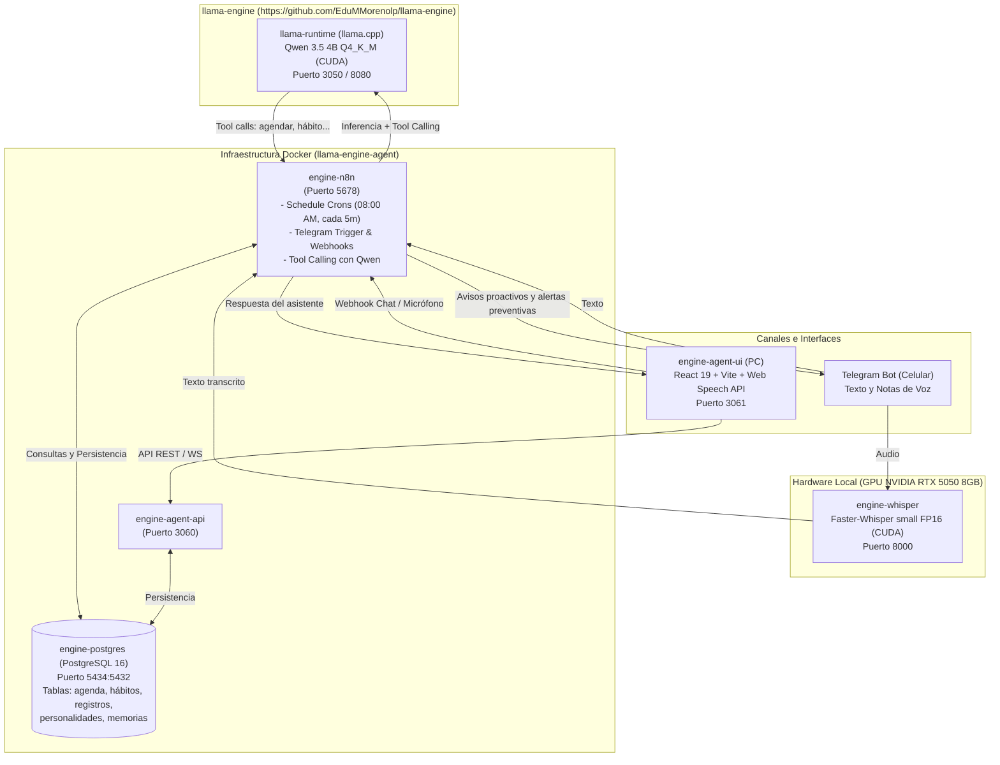

# llama-engine-agent

> **Asistente personal proactivo local** conectado al motor de inferencia [llama-engine](https://github.com/EduMMorenolp/llama-engine).
> Utiliza el modelo **Qwen 3.5 4B** corriendo sobre `llama.cpp` con aceleración GPU (NVIDIA RTX 5050 8GB).
> Arquitectura modular: cada servicio en su propia carpeta con su Dockerfile, orquestado desde un `docker-compose.yml` central en la raíz.

---

## 🔗 Ecosistema y Relación con llama-engine

Este proyecto es el módulo de agente inteligente y asistencia proactiva del ecosistema **llama-engine**:

- **Runtime de Inferencia (Core)**: [EduMMorenolp/llama-engine](https://github.com/EduMMorenolp/llama-engine) provee `llama-runtime` (`llama.cpp` compilado con CUDA) y `engine-api` en el puerto `3050`/`8080`, sirviendo la API compatible con OpenAI para Qwen 3.5 4B.
- **Cerebro y Asistencia Proactiva**: **llama-engine-agent** (este repositorio) consume esa API, orquesta la memoria, la agenda diaria, los hábitos y las interacciones multicanal (Telegram y Web) mediante flujos en n8n y persistencia en PostgreSQL 16.

---

## 📁 Estructura Modular del Proyecto

```
llama-engine-agent/
├── .vscode/
│   └── tasks.json               # Tareas para encender servicios desde VS Code
├── docs/                        # Documentación formal (PRD, Arquitectura, Tareas)
├── engine-agent/
│   ├── README.md                # Descripción de submódulos cliente/API
│   ├── engine-agent-api/        # Servidor backend/bridge API (Express + TS)
│   │   ├── Dockerfile
│   │   ├── src/
│   │   └── package.json
│   └── engine-agent-ui/         # Frontend Web con Web Speech API (React 19 + Vite)
│       ├── Dockerfile
│       ├── src/
│       └── package.json
├── engine-n8n/
│   ├── Dockerfile               # Contenedor n8n customizado
│   ├── README.md                # Guía de workflows y credenciales
│   └── workflows/               # Flujos JSON exportados (Saludo, Cerebro, Reloj)
├── engine-postgres/
│   ├── Dockerfile               # PostgreSQL 16 Alpine con init scripts
│   ├── README.md                # Documentación de tablas e índices
│   └── init/
│       ├── 01_schema.sql        # Esquema DDL optimizado (Supabase Best Practices)
│       └── 02_seed.sql          # Personalidades y hábitos por defecto
├── engine-whisper/
│   ├── Dockerfile               # Faster-Whisper Server con CUDA (FP16)
│   └── README.md                # Documentación del endpoint STT
├── .env                         # Variables de entorno locales
├── .env.example                 # Plantilla de configuración
├── .gitignore
├── AGENTS.md                    # Instrucciones y reglas para el agente
├── CHANGELOG.md                 # Historial estructurado de cambios
├── docker-compose.yml           # Orquestación de todos los servicios
└── README.md
```

---

## ⚡ Servicios, Puertos y Consumo

| Servicio | Carpeta | Rol | Puerto / Endpoint | Consumo Aprox. |
|---|---|---|---|---|
| **llama-runtime** | `llama-engine` | Inferencia LLM (Qwen 3.5 4B Q4_K_M) | `http://localhost:3050` / `8080` | ~3.5 GB VRAM |
| **engine-whisper** | `./engine-whisper` | Transcripción STT de notas de voz con CUDA | `http://localhost:8000` | ~1.0 GB VRAM |
| **engine-postgres** | `./engine-postgres` | Base de datos persistente (agenda, hábitos) | `localhost:5434` (interno 5432) | ~100 MB RAM |
| **engine-n8n** | `./engine-n8n` | Orquestador de eventos, crons y tool calling | `http://localhost:5678` | ~400 MB RAM |
| **engine-agent-api**| `./engine-agent/engine-agent-api` | API REST & WebSocket del agente con 18 tools agénticas | `http://localhost:3060` | ~80 MB RAM |
| **engine-agent-ui** | `./engine-agent/engine-agent-ui` | Dashboard web, gestor de memorias, inspección de tools y temas | `http://localhost:3061` | Navegador (0 VRAM) |

---

## 🏛️ Arquitectura



---

## 🚀 Puesta en Marcha Rápida

### 1. Iniciar Servicios con Docker

```powershell
# Iniciar todos los servicios del agente
docker compose up -d

# O iniciar solo la base de datos, Whisper y n8n:
docker compose up -d engine-postgres engine-whisper engine-n8n

# Ver estado y logs
docker compose ps
docker compose logs -f
```

### 2. Configurar e Importar Flujos en n8n

1. Abrir n8n en `http://localhost:5678`.
2. Crear las **Credenciales**:
   - **Postgres**: Host: `engine-postgres` (o `localhost`), Puerto: `5434` (o `5432` si es dentro de la red docker), DB: `agent_db`, Usuario: `agent_user`, Password: `agent_secret_password`.
   - **Telegram API**: Token de tu bot de [@BotFather](https://t.me/botfather).
3. Importar los 4 flujos ubicados en `engine-n8n/workflows/`:
   - `01_saludo_matutino.json`
   - `02_cerebro_conversacional.json`
   - `03_reloj_vigilante.json`
   - `04_api_webhook_web_ui.json`
4. Activar los flujos en n8n (**Active: ON**).

### 3. Desarrollo Local del Frontend Web

Si preferís correr la Web UI en modo desarrollo local:

```powershell
cd engine-agent/engine-agent-ui
npm install
npm run dev
```

Disponible en `http://localhost:3061` con dictado de voz nativo en español por Web Speech API.

---

## 🛠️ Tareas en VS Code

El archivo `.vscode/tasks.json` incluye:
- **`🐳 Docker: Todos los Servicios`**: Levanta el compose completo.
- **`🐳 Docker: Postgres, Whisper & n8n`**: Levanta los motores de backend en Docker.
- **`🎨 Web UI: engine-agent-ui`**: Inicia el frontend en modo dev.
- **`🚀 ALL: Levantar Asistente (Docker + UI)`**: Enciende Docker y la UI en paralelo.

---

## 📄 Licencia y Buenas Prácticas

- Esquema de base de datos optimizado bajo las directivas de `supabase-postgres-best-practices`.
- Contratos de endpoints estandarizados con `contrato-api-global`.
- Historial estricto de versiones en [CHANGELOG.md](./CHANGELOG.md).
