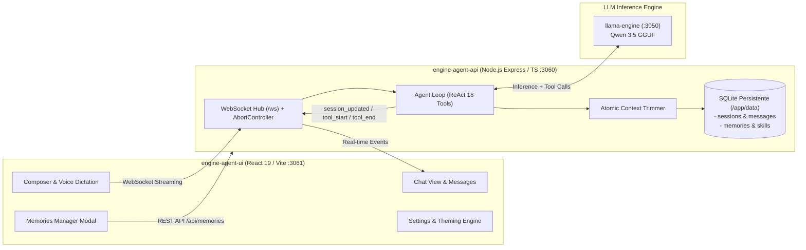

# Arquitectura de la Solución — llama-engine-agent

## 1. Diagrama General de Componentes

```

---

## 5. Arquitectura del Asistente Agéntico (`engine-agent`)

El subsistema `engine-agent` proporciona la interfaz conversacional avanzada con capacidades agénticas locales:



### Componentes Clave:
1. **Sidebar Principal & Navegación Agrupada (`Sidebar.tsx`)**: Menú lateral principal con diseño idéntico a `llama-engine` en color azul base, navegación colapsable entre `/` (Chats), `/agents` (Agentes y personalidades), `/skills` (Skills), `/tools` (Herramientas), `/mcp` (Servidores MCP), `/memories` (Memorias) y `/settings` (Configuración), con tarjeta de runtime en vivo al pie.
2. **Topbar con Pestañas Multi-Chat y Gestión de Contexto (`Topbar.tsx`)**: Breadcrumbs de navegación, pestañas con indicadores circulares de color por agente, selector de modelo, indicador visual de porcentaje de contexto con popover de desglose (System, Skills, Historial) y botón de compactación inmediata.
3. **Sub-sidebar Organizador por Conversación (`ChatSubSidebar.tsx`)**: Panel lateral izquierdo dedicado dentro del chat (con barra compacta de 44px al colapsar) que organiza sesiones de chat con buscador en tiempo real, selector de personalidad de agente y accesos al System Prompt.
4. **Inspector Agéntico en Vivo (`ChatInspector.tsx`)**: Panel lateral derecho colapsable con bloques vivos: Toggles de activación de Skills & MCP (`web_search`, `execute_bash`, etc.) y chips de Memorias persistentes.
5. **Human-in-the-Loop & Acciones Rápidas (`HitlConfirmationCard.tsx`, `MessageBubble.tsx`)**: Tarjeta de confirmación previa para comandos de terminal (`bash`) y manipulación de archivos con botones Permitir y Rechazar, y barra de acciones (Copiar, Regenerar, Fijar, Bifurcar, TTS).
6. **Panel de Artifacts / Canvas (`ArtifactPanel.tsx`)**: Renderizador dividido a pantalla partida y pantalla completa para código, HTML en iframe sandbox y SVG seguro, con cambio de pestañas Vista Previa/Código y descarga directa.
7. **Paleta de Comandos & Slash Commands (`CommandPaletteModal.tsx`, `Composer.tsx`)**: Atajo global `Ctrl+K` para orquestación instantánea de sesiones y acciones, junto con menú reactivo `/` en el área de redacción.
8. **Modo Asistente de Voz Bidireccional (`useSpeechSynthesis.ts`, `VoiceOrb.tsx`)**: Síntesis TTS en el navegador con limpieza de bloques de razonamiento, botón de altavoz en mensajes y widget flotante `VoiceOrb` animado con ondas sonoras.
9. **Árbol y Variantes de Mensajes (`MessageBubble.tsx`)**: Paginación `< 1 / n >` para alternar entre regeneraciones de respuestas conservando todo el historial.
10. **Atomic Context Trimmer (`src/agent/prompt.ts`)**: Agrupa de forma indivisible los mensajes del asistente con llamadas a herramientas y las subsecuentes respuestas `tool`. Evita mensajes huérfanos que violan el contrato de la API de inferencia.
11. **WebSocket Hub con AbortController (`src/ws.ts`)**: Permite la detención inmediata de ejecuciones agénticas activas cuando el usuario pulsa detener en la UI o se interrumpe la conexión, previniendo consumo fantasma de GPU.
12. **Eventos Reactivos de Sesión (`session_updated`)**: Actualiza en tiempo real el título autogenerado de la conversación en la barra lateral del cliente sin requerir recarga.
13. **Inspección de Herramientas (`ToolCallItem`)**: Visualizador interactivo que desglosa argumentos, estados de ejecución y salidas producidas por cada tool ejecutada.
14. **Gestor de Memorias (`MemoriesModal`)**: CRUD reactivo de memorias persistentes (`/api/memories`) con etiquetado dinámico y búsqueda en tiempo real.
mermaid
flowchart TD
    subgraph Hardware["Hardware Local (NVIDIA RTX 5050 8GB / 16GB RAM)"]
        LLAMA["llama-runtime (llama.cpp)\nQwen 3.5 4B Q4_K_M\nPuerto 3050 / 8080"]
        WHISPER["Faster-Whisper Server\nModelo small FP16 (CUDA)\nPuerto 8000"]
    end

    subgraph Docker_Services["Contenedores Docker"]
        POSTGRES[("PostgreSQL 16 (Dedicado)\nPuerto 5434:5432\nTablas: agenda, habitos, registros,\npersonalidades, memorias")]
        N8N["n8n Orquestador\n(n8n-docker en puerto 5678)\n- Schedule Crons (08:00 AM, cada 5 min)\n- Telegram Trigger & Webhooks\n- Tool Calling Execution"]
    end

    subgraph Canales["Canales de Interacción"]
        TG["Telegram Bot (Celular)\nTexto y Notas de voz"]
        WEB["engine-ui-agent (PC)\nReact 19 + Vite + Web Speech API\nPuerto 3061"]
    end

    TG -->|Audio| WHISPER
    WHISPER -->|Texto transcrito| N8N
    TG -->|Mensaje de texto| N8N
    WEB -->|Webhook Chat / Dictado de voz| N8N

    N8N -->|Inferencia + Tool Calling| LLAMA
    LLAMA -->|Herramientas a ejecutar| N8N
    N8N <-->|Consultas y Persistencia SQL| POSTGRES

    N8N -->|Avisos proactivos matutinos y alertas| TG
    N8N -->|Respuesta del asistente| WEB
```

---

## 5. Arquitectura del Asistente Agéntico (`engine-agent`)

El subsistema `engine-agent` proporciona la interfaz conversacional avanzada con capacidades agénticas locales:


### Componentes Clave:
1. **Sidebar Principal & Navegación Agrupada (`Sidebar.tsx`)**: Menú lateral principal con diseño idéntico a `llama-engine` en color azul base, navegación colapsable entre `/` (Chats), `/agents` (Agentes y personalidades), `/skills` (Skills), `/tools` (Herramientas), `/mcp` (Servidores MCP), `/memories` (Memorias) y `/settings` (Configuración), con tarjeta de runtime en vivo al pie.
2. **Topbar con Pestañas Multi-Chat y Gestión de Contexto (`Topbar.tsx`)**: Breadcrumbs de navegación, pestañas con indicadores circulares de color por agente, selector de modelo, indicador visual de porcentaje de contexto con popover de desglose (System, Skills, Historial) y botón de compactación inmediata.
3. **Sub-sidebar Organizador por Conversación (`ChatSubSidebar.tsx`)**: Panel lateral izquierdo dedicado dentro del chat (con barra compacta de 44px al colapsar) que organiza sesiones de chat con buscador en tiempo real, selector de personalidad de agente y accesos al System Prompt.
4. **Inspector Agéntico en Vivo (`ChatInspector.tsx`)**: Panel lateral derecho colapsable con bloques vivos: Toggles de activación de Skills & MCP (`web_search`, `execute_bash`, etc.) y chips de Memorias persistentes.
5. **Human-in-the-Loop & Acciones Rápidas (`HitlConfirmationCard.tsx`, `MessageBubble.tsx`)**: Tarjeta de confirmación previa para comandos de terminal (`bash`) y manipulación de archivos con botones Permitir y Rechazar, y barra de acciones (Copiar, Regenerar, Fijar, Bifurcar, TTS).
6. **Panel de Artifacts / Canvas (`ArtifactPanel.tsx`)**: Renderizador dividido a pantalla partida y pantalla completa para código, HTML en iframe sandbox y SVG seguro, con cambio de pestañas Vista Previa/Código y descarga directa.
7. **Paleta de Comandos & Slash Commands (`CommandPaletteModal.tsx`, `Composer.tsx`)**: Atajo global `Ctrl+K` para orquestación instantánea de sesiones y acciones, junto con menú reactivo `/` en el área de redacción.
8. **Modo Asistente de Voz Bidireccional (`useSpeechSynthesis.ts`, `VoiceOrb.tsx`)**: Síntesis TTS en el navegador con limpieza de bloques de razonamiento, botón de altavoz en mensajes y widget flotante `VoiceOrb` animado con ondas sonoras.
9. **Árbol y Variantes de Mensajes (`MessageBubble.tsx`)**: Paginación `< 1 / n >` para alternar entre regeneraciones de respuestas conservando todo el historial.
10. **Atomic Context Trimmer (`src/agent/prompt.ts`)**: Agrupa de forma indivisible los mensajes del asistente con llamadas a herramientas y las subsecuentes respuestas `tool`. Evita mensajes huérfanos que violan el contrato de la API de inferencia.
11. **WebSocket Hub con AbortController (`src/ws.ts`)**: Permite la detención inmediata de ejecuciones agénticas activas cuando el usuario pulsa detener en la UI o se interrumpe la conexión, previniendo consumo fantasma de GPU.
12. **Eventos Reactivos de Sesión (`session_updated`)**: Actualiza en tiempo real el título autogenerado de la conversación en la barra lateral del cliente sin requerir recarga.
13. **Inspección de Herramientas (`ToolCallItem`)**: Visualizador interactivo que desglosa argumentos, estados de ejecución y salidas producidas por cada tool ejecutada.
14. **Gestor de Memorias (`MemoriesModal`)**: CRUD reactivo de memorias persistentes (`/api/memories`) con etiquetado dinámico y búsqueda en tiempo real.


---

## 2. Flujo de Secuencia: Disparador Matutino (Buenos Días)

```

---

## 5. Arquitectura del Asistente Agéntico (`engine-agent`)

El subsistema `engine-agent` proporciona la interfaz conversacional avanzada con capacidades agénticas locales:


### Componentes Clave:
1. **Sidebar Principal & Navegación Agrupada (`Sidebar.tsx`)**: Menú lateral principal con diseño idéntico a `llama-engine` en color azul base, navegación colapsable entre `/` (Chats), `/agents` (Agentes y personalidades), `/skills` (Skills), `/tools` (Herramientas), `/mcp` (Servidores MCP), `/memories` (Memorias) y `/settings` (Configuración), con tarjeta de runtime en vivo al pie.
2. **Topbar con Pestañas Multi-Chat y Gestión de Contexto (`Topbar.tsx`)**: Breadcrumbs de navegación, pestañas con indicadores circulares de color por agente, selector de modelo, indicador visual de porcentaje de contexto con popover de desglose (System, Skills, Historial) y botón de compactación inmediata.
3. **Sub-sidebar Organizador por Conversación (`ChatSubSidebar.tsx`)**: Panel lateral izquierdo dedicado dentro del chat (con barra compacta de 44px al colapsar) que organiza sesiones de chat con buscador en tiempo real, selector de personalidad de agente y accesos al System Prompt.
4. **Inspector Agéntico en Vivo (`ChatInspector.tsx`)**: Panel lateral derecho colapsable con bloques vivos: Toggles de activación de Skills & MCP (`web_search`, `execute_bash`, etc.) y chips de Memorias persistentes.
5. **Human-in-the-Loop & Acciones Rápidas (`HitlConfirmationCard.tsx`, `MessageBubble.tsx`)**: Tarjeta de confirmación previa para comandos de terminal (`bash`) y manipulación de archivos con botones Permitir y Rechazar, y barra de acciones (Copiar, Regenerar, Fijar, Bifurcar, TTS).
6. **Panel de Artifacts / Canvas (`ArtifactPanel.tsx`)**: Renderizador dividido a pantalla partida y pantalla completa para código, HTML en iframe sandbox y SVG seguro, con cambio de pestañas Vista Previa/Código y descarga directa.
7. **Paleta de Comandos & Slash Commands (`CommandPaletteModal.tsx`, `Composer.tsx`)**: Atajo global `Ctrl+K` para orquestación instantánea de sesiones y acciones, junto con menú reactivo `/` en el área de redacción.
8. **Modo Asistente de Voz Bidireccional (`useSpeechSynthesis.ts`, `VoiceOrb.tsx`)**: Síntesis TTS en el navegador con limpieza de bloques de razonamiento, botón de altavoz en mensajes y widget flotante `VoiceOrb` animado con ondas sonoras.
9. **Árbol y Variantes de Mensajes (`MessageBubble.tsx`)**: Paginación `< 1 / n >` para alternar entre regeneraciones de respuestas conservando todo el historial.
10. **Atomic Context Trimmer (`src/agent/prompt.ts`)**: Agrupa de forma indivisible los mensajes del asistente con llamadas a herramientas y las subsecuentes respuestas `tool`. Evita mensajes huérfanos que violan el contrato de la API de inferencia.
11. **WebSocket Hub con AbortController (`src/ws.ts`)**: Permite la detención inmediata de ejecuciones agénticas activas cuando el usuario pulsa detener en la UI o se interrumpe la conexión, previniendo consumo fantasma de GPU.
12. **Eventos Reactivos de Sesión (`session_updated`)**: Actualiza en tiempo real el título autogenerado de la conversación en la barra lateral del cliente sin requerir recarga.
13. **Inspección de Herramientas (`ToolCallItem`)**: Visualizador interactivo que desglosa argumentos, estados de ejecución y salidas producidas por cada tool ejecutada.
14. **Gestor de Memorias (`MemoriesModal`)**: CRUD reactivo de memorias persistentes (`/api/memories`) con etiquetado dinámico y búsqueda en tiempo real.
mermaid
sequenceDiagram
    autonumber
    participant Cron as n8n (Schedule 08:00 AM)
    participant PG as PostgreSQL (Puerto 5434)
    participant LLM as Qwen 3.5 4B (Puerto 3050)
    participant TG as Telegram (Usuario)

    Cron->>PG: SELECT personalidad activa y agenda de hoy
    PG-->>Cron: System prompt + actividades previas
    Cron->>LLM: Redactar saludo cordial y preguntar actividades del día
    LLM-->>Cron: Texto del saludo generado
    Cron->>TG: Enviar mensaje de buenos días por Telegram
```

---

## 5. Arquitectura del Asistente Agéntico (`engine-agent`)

El subsistema `engine-agent` proporciona la interfaz conversacional avanzada con capacidades agénticas locales:


### Componentes Clave:
1. **Sidebar Principal & Navegación Agrupada (`Sidebar.tsx`)**: Menú lateral principal con diseño idéntico a `llama-engine` en color azul base, navegación colapsable entre `/` (Chats), `/agents` (Agentes y personalidades), `/skills` (Skills), `/tools` (Herramientas), `/mcp` (Servidores MCP), `/memories` (Memorias) y `/settings` (Configuración), con tarjeta de runtime en vivo al pie.
2. **Topbar con Pestañas Multi-Chat y Gestión de Contexto (`Topbar.tsx`)**: Breadcrumbs de navegación, pestañas con indicadores circulares de color por agente, selector de modelo, indicador visual de porcentaje de contexto con popover de desglose (System, Skills, Historial) y botón de compactación inmediata.
3. **Sub-sidebar Organizador por Conversación (`ChatSubSidebar.tsx`)**: Panel lateral izquierdo dedicado dentro del chat (con barra compacta de 44px al colapsar) que organiza sesiones de chat con buscador en tiempo real, selector de personalidad de agente y accesos al System Prompt.
4. **Inspector Agéntico en Vivo (`ChatInspector.tsx`)**: Panel lateral derecho colapsable con bloques vivos: Toggles de activación de Skills & MCP (`web_search`, `execute_bash`, etc.) y chips de Memorias persistentes.
5. **Human-in-the-Loop & Acciones Rápidas (`HitlConfirmationCard.tsx`, `MessageBubble.tsx`)**: Tarjeta de confirmación previa para comandos de terminal (`bash`) y manipulación de archivos con botones Permitir y Rechazar, y barra de acciones (Copiar, Regenerar, Fijar, Bifurcar, TTS).
6. **Panel de Artifacts / Canvas (`ArtifactPanel.tsx`)**: Renderizador dividido a pantalla partida y pantalla completa para código, HTML en iframe sandbox y SVG seguro, con cambio de pestañas Vista Previa/Código y descarga directa.
7. **Paleta de Comandos & Slash Commands (`CommandPaletteModal.tsx`, `Composer.tsx`)**: Atajo global `Ctrl+K` para orquestación instantánea de sesiones y acciones, junto con menú reactivo `/` en el área de redacción.
8. **Modo Asistente de Voz Bidireccional (`useSpeechSynthesis.ts`, `VoiceOrb.tsx`)**: Síntesis TTS en el navegador con limpieza de bloques de razonamiento, botón de altavoz en mensajes y widget flotante `VoiceOrb` animado con ondas sonoras.
9. **Árbol y Variantes de Mensajes (`MessageBubble.tsx`)**: Paginación `< 1 / n >` para alternar entre regeneraciones de respuestas conservando todo el historial.
10. **Atomic Context Trimmer (`src/agent/prompt.ts`)**: Agrupa de forma indivisible los mensajes del asistente con llamadas a herramientas y las subsecuentes respuestas `tool`. Evita mensajes huérfanos que violan el contrato de la API de inferencia.
11. **WebSocket Hub con AbortController (`src/ws.ts`)**: Permite la detención inmediata de ejecuciones agénticas activas cuando el usuario pulsa detener en la UI o se interrumpe la conexión, previniendo consumo fantasma de GPU.
12. **Eventos Reactivos de Sesión (`session_updated`)**: Actualiza en tiempo real el título autogenerado de la conversación en la barra lateral del cliente sin requerir recarga.
13. **Inspección de Herramientas (`ToolCallItem`)**: Visualizador interactivo que desglosa argumentos, estados de ejecución y salidas producidas por cada tool ejecutada.
14. **Gestor de Memorias (`MemoriesModal`)**: CRUD reactivo de memorias persistentes (`/api/memories`) con etiquetado dinámico y búsqueda en tiempo real.


---

## 3. Flujo de Secuencia: Mensaje de Voz y Agendamiento

```

---

## 5. Arquitectura del Asistente Agéntico (`engine-agent`)

El subsistema `engine-agent` proporciona la interfaz conversacional avanzada con capacidades agénticas locales:


### Componentes Clave:
1. **Sidebar Principal & Navegación Agrupada (`Sidebar.tsx`)**: Menú lateral principal con diseño idéntico a `llama-engine` en color azul base, navegación colapsable entre `/` (Chats), `/agents` (Agentes y personalidades), `/skills` (Skills), `/tools` (Herramientas), `/mcp` (Servidores MCP), `/memories` (Memorias) y `/settings` (Configuración), con tarjeta de runtime en vivo al pie.
2. **Topbar con Pestañas Multi-Chat y Gestión de Contexto (`Topbar.tsx`)**: Breadcrumbs de navegación, pestañas con indicadores circulares de color por agente, selector de modelo, indicador visual de porcentaje de contexto con popover de desglose (System, Skills, Historial) y botón de compactación inmediata.
3. **Sub-sidebar Organizador por Conversación (`ChatSubSidebar.tsx`)**: Panel lateral izquierdo dedicado dentro del chat (con barra compacta de 44px al colapsar) que organiza sesiones de chat con buscador en tiempo real, selector de personalidad de agente y accesos al System Prompt.
4. **Inspector Agéntico en Vivo (`ChatInspector.tsx`)**: Panel lateral derecho colapsable con bloques vivos: Toggles de activación de Skills & MCP (`web_search`, `execute_bash`, etc.) y chips de Memorias persistentes.
5. **Human-in-the-Loop & Acciones Rápidas (`HitlConfirmationCard.tsx`, `MessageBubble.tsx`)**: Tarjeta de confirmación previa para comandos de terminal (`bash`) y manipulación de archivos con botones Permitir y Rechazar, y barra de acciones (Copiar, Regenerar, Fijar, Bifurcar, TTS).
6. **Panel de Artifacts / Canvas (`ArtifactPanel.tsx`)**: Renderizador dividido a pantalla partida y pantalla completa para código, HTML en iframe sandbox y SVG seguro, con cambio de pestañas Vista Previa/Código y descarga directa.
7. **Paleta de Comandos & Slash Commands (`CommandPaletteModal.tsx`, `Composer.tsx`)**: Atajo global `Ctrl+K` para orquestación instantánea de sesiones y acciones, junto con menú reactivo `/` en el área de redacción.
8. **Modo Asistente de Voz Bidireccional (`useSpeechSynthesis.ts`, `VoiceOrb.tsx`)**: Síntesis TTS en el navegador con limpieza de bloques de razonamiento, botón de altavoz en mensajes y widget flotante `VoiceOrb` animado con ondas sonoras.
9. **Árbol y Variantes de Mensajes (`MessageBubble.tsx`)**: Paginación `< 1 / n >` para alternar entre regeneraciones de respuestas conservando todo el historial.
10. **Atomic Context Trimmer (`src/agent/prompt.ts`)**: Agrupa de forma indivisible los mensajes del asistente con llamadas a herramientas y las subsecuentes respuestas `tool`. Evita mensajes huérfanos que violan el contrato de la API de inferencia.
11. **WebSocket Hub con AbortController (`src/ws.ts`)**: Permite la detención inmediata de ejecuciones agénticas activas cuando el usuario pulsa detener en la UI o se interrumpe la conexión, previniendo consumo fantasma de GPU.
12. **Eventos Reactivos de Sesión (`session_updated`)**: Actualiza en tiempo real el título autogenerado de la conversación en la barra lateral del cliente sin requerir recarga.
13. **Inspección de Herramientas (`ToolCallItem`)**: Visualizador interactivo que desglosa argumentos, estados de ejecución y salidas producidas por cada tool ejecutada.
14. **Gestor de Memorias (`MemoriesModal`)**: CRUD reactivo de memorias persistentes (`/api/memories`) con etiquetado dinámico y búsqueda en tiempo real.
mermaid
sequenceDiagram
    autonumber
    participant User as Usuario (Telegram)
    participant TG as Bot de Telegram
    participant N8N as n8n Orquestador
    participant FW as Faster-Whisper (CUDA)
    participant LLM as Qwen 3.5 4B
    participant PG as PostgreSQL

    User->>TG: Envía nota de voz ("Hoy a las 18:00 voy al gimnasio")
    TG->>N8N: Evento message.voice
    N8N->>FW: POST /v1/audio/transcriptions (archivo de audio)
    FW-->>N8N: Texto: "Hoy a las 18:00 voy al gimnasio"
    N8N->>LLM: Prompt con fecha/hora actual y tools disponibles
    LLM-->>N8N: Tool Call: agendar_actividad(hora="18:00", actividad="Gimnasio")
    N8N->>PG: INSERT INTO agenda_diaria (fecha, hora, actividad)
    PG-->>N8N: Confirmación OK
    N8N->>TG: "✅ Agendé 'Gimnasio' a las 18:00 para hoy."
    TG-->>User: Mensaje en Telegram
```

---

## 5. Arquitectura del Asistente Agéntico (`engine-agent`)

El subsistema `engine-agent` proporciona la interfaz conversacional avanzada con capacidades agénticas locales:


### Componentes Clave:
1. **Sidebar Principal & Navegación Agrupada (`Sidebar.tsx`)**: Menú lateral principal con diseño idéntico a `llama-engine` en color azul base, navegación colapsable entre `/` (Chats), `/agents` (Agentes y personalidades), `/skills` (Skills), `/tools` (Herramientas), `/mcp` (Servidores MCP), `/memories` (Memorias) y `/settings` (Configuración), con tarjeta de runtime en vivo al pie.
2. **Topbar con Pestañas Multi-Chat y Gestión de Contexto (`Topbar.tsx`)**: Breadcrumbs de navegación, pestañas con indicadores circulares de color por agente, selector de modelo, indicador visual de porcentaje de contexto con popover de desglose (System, Skills, Historial) y botón de compactación inmediata.
3. **Sub-sidebar Organizador por Conversación (`ChatSubSidebar.tsx`)**: Panel lateral izquierdo dedicado dentro del chat (con barra compacta de 44px al colapsar) que organiza sesiones de chat con buscador en tiempo real, selector de personalidad de agente y accesos al System Prompt.
4. **Inspector Agéntico en Vivo (`ChatInspector.tsx`)**: Panel lateral derecho colapsable con bloques vivos: Toggles de activación de Skills & MCP (`web_search`, `execute_bash`, etc.) y chips de Memorias persistentes.
5. **Human-in-the-Loop & Acciones Rápidas (`HitlConfirmationCard.tsx`, `MessageBubble.tsx`)**: Tarjeta de confirmación previa para comandos de terminal (`bash`) y manipulación de archivos con botones Permitir y Rechazar, y barra de acciones (Copiar, Regenerar, Fijar, Bifurcar, TTS).
6. **Panel de Artifacts / Canvas (`ArtifactPanel.tsx`)**: Renderizador dividido a pantalla partida y pantalla completa para código, HTML en iframe sandbox y SVG seguro, con cambio de pestañas Vista Previa/Código y descarga directa.
7. **Paleta de Comandos & Slash Commands (`CommandPaletteModal.tsx`, `Composer.tsx`)**: Atajo global `Ctrl+K` para orquestación instantánea de sesiones y acciones, junto con menú reactivo `/` en el área de redacción.
8. **Modo Asistente de Voz Bidireccional (`useSpeechSynthesis.ts`, `VoiceOrb.tsx`)**: Síntesis TTS en el navegador con limpieza de bloques de razonamiento, botón de altavoz en mensajes y widget flotante `VoiceOrb` animado con ondas sonoras.
9. **Árbol y Variantes de Mensajes (`MessageBubble.tsx`)**: Paginación `< 1 / n >` para alternar entre regeneraciones de respuestas conservando todo el historial.
10. **Atomic Context Trimmer (`src/agent/prompt.ts`)**: Agrupa de forma indivisible los mensajes del asistente con llamadas a herramientas y las subsecuentes respuestas `tool`. Evita mensajes huérfanos que violan el contrato de la API de inferencia.
11. **WebSocket Hub con AbortController (`src/ws.ts`)**: Permite la detención inmediata de ejecuciones agénticas activas cuando el usuario pulsa detener en la UI o se interrumpe la conexión, previniendo consumo fantasma de GPU.
12. **Eventos Reactivos de Sesión (`session_updated`)**: Actualiza en tiempo real el título autogenerado de la conversación en la barra lateral del cliente sin requerir recarga.
13. **Inspección de Herramientas (`ToolCallItem`)**: Visualizador interactivo que desglosa argumentos, estados de ejecución y salidas producidas por cada tool ejecutada.
14. **Gestor de Memorias (`MemoriesModal`)**: CRUD reactivo de memorias persistentes (`/api/memories`) con etiquetado dinámico y búsqueda en tiempo real.


---

## 4. Flujo de Secuencia: Reloj Vigilante (Recordatorios y Hábitos)

```

---

## 5. Arquitectura del Asistente Agéntico (`engine-agent`)

El subsistema `engine-agent` proporciona la interfaz conversacional avanzada con capacidades agénticas locales:


### Componentes Clave:
1. **Sidebar Principal & Navegación Agrupada (`Sidebar.tsx`)**: Menú lateral principal con diseño idéntico a `llama-engine` en color azul base, navegación colapsable entre `/` (Chats), `/agents` (Agentes y personalidades), `/skills` (Skills), `/tools` (Herramientas), `/mcp` (Servidores MCP), `/memories` (Memorias) y `/settings` (Configuración), con tarjeta de runtime en vivo al pie.
2. **Topbar con Pestañas Multi-Chat y Gestión de Contexto (`Topbar.tsx`)**: Breadcrumbs de navegación, pestañas con indicadores circulares de color por agente, selector de modelo, indicador visual de porcentaje de contexto con popover de desglose (System, Skills, Historial) y botón de compactación inmediata.
3. **Sub-sidebar Organizador por Conversación (`ChatSubSidebar.tsx`)**: Panel lateral izquierdo dedicado dentro del chat (con barra compacta de 44px al colapsar) que organiza sesiones de chat con buscador en tiempo real, selector de personalidad de agente y accesos al System Prompt.
4. **Inspector Agéntico en Vivo (`ChatInspector.tsx`)**: Panel lateral derecho colapsable con bloques vivos: Toggles de activación de Skills & MCP (`web_search`, `execute_bash`, etc.) y chips de Memorias persistentes.
5. **Human-in-the-Loop & Acciones Rápidas (`HitlConfirmationCard.tsx`, `MessageBubble.tsx`)**: Tarjeta de confirmación previa para comandos de terminal (`bash`) y manipulación de archivos con botones Permitir y Rechazar, y barra de acciones (Copiar, Regenerar, Fijar, Bifurcar, TTS).
6. **Panel de Artifacts / Canvas (`ArtifactPanel.tsx`)**: Renderizador dividido a pantalla partida y pantalla completa para código, HTML en iframe sandbox y SVG seguro, con cambio de pestañas Vista Previa/Código y descarga directa.
7. **Paleta de Comandos & Slash Commands (`CommandPaletteModal.tsx`, `Composer.tsx`)**: Atajo global `Ctrl+K` para orquestación instantánea de sesiones y acciones, junto con menú reactivo `/` en el área de redacción.
8. **Modo Asistente de Voz Bidireccional (`useSpeechSynthesis.ts`, `VoiceOrb.tsx`)**: Síntesis TTS en el navegador con limpieza de bloques de razonamiento, botón de altavoz en mensajes y widget flotante `VoiceOrb` animado con ondas sonoras.
9. **Árbol y Variantes de Mensajes (`MessageBubble.tsx`)**: Paginación `< 1 / n >` para alternar entre regeneraciones de respuestas conservando todo el historial.
10. **Atomic Context Trimmer (`src/agent/prompt.ts`)**: Agrupa de forma indivisible los mensajes del asistente con llamadas a herramientas y las subsecuentes respuestas `tool`. Evita mensajes huérfanos que violan el contrato de la API de inferencia.
11. **WebSocket Hub con AbortController (`src/ws.ts`)**: Permite la detención inmediata de ejecuciones agénticas activas cuando el usuario pulsa detener en la UI o se interrumpe la conexión, previniendo consumo fantasma de GPU.
12. **Eventos Reactivos de Sesión (`session_updated`)**: Actualiza en tiempo real el título autogenerado de la conversación en la barra lateral del cliente sin requerir recarga.
13. **Inspección de Herramientas (`ToolCallItem`)**: Visualizador interactivo que desglosa argumentos, estados de ejecución y salidas producidas por cada tool ejecutada.
14. **Gestor de Memorias (`MemoriesModal`)**: CRUD reactivo de memorias persistentes (`/api/memories`) con etiquetado dinámico y búsqueda en tiempo real.
mermaid
sequenceDiagram
    autonumber
    participant Cron as n8n (Schedule cada 5 min)
    participant PG as PostgreSQL
    participant TG as Telegram

    Cron->>PG: 1. SELECT actividades entre now() y now()+15m (recordado=false)
    alt Hay actividad próxima
        PG-->>Cron: Actividad encontrada
        Cron->>TG: "⏰ Recordatorio: a las 18:00 tienes Gimnasio."
        Cron->>PG: UPDATE agenda_diaria SET recordado = true
    end

    Cron->>PG: 2. SELECT habitos activos donde hora_disparo ≈ hora_actual
    alt Coincide hora de hábito
        PG-->>Cron: Hábito: Almuerzo ("¿Qué almorzaste hoy?")
        Cron->>TG: "📌 Seguimiento: ¿Qué almorzaste hoy?"
    end
```

---

## 5. Arquitectura del Asistente Agéntico (`engine-agent`)

El subsistema `engine-agent` proporciona la interfaz conversacional avanzada con capacidades agénticas locales:


### Componentes Clave:
1. **Sidebar Principal & Navegación Agrupada (`Sidebar.tsx`)**: Menú lateral principal con diseño idéntico a `llama-engine` en color azul base, navegación colapsable entre `/` (Chats), `/agents` (Agentes y personalidades), `/skills` (Skills), `/tools` (Herramientas), `/mcp` (Servidores MCP), `/memories` (Memorias) y `/settings` (Configuración), con tarjeta de runtime en vivo al pie.
2. **Topbar con Pestañas Multi-Chat y Gestión de Contexto (`Topbar.tsx`)**: Breadcrumbs de navegación, pestañas con indicadores circulares de color por agente, selector de modelo, indicador visual de porcentaje de contexto con popover de desglose (System, Skills, Historial) y botón de compactación inmediata.
3. **Sub-sidebar Organizador por Conversación (`ChatSubSidebar.tsx`)**: Panel lateral izquierdo dedicado dentro del chat (con barra compacta de 44px al colapsar) que organiza sesiones de chat con buscador en tiempo real, selector de personalidad de agente y accesos al System Prompt.
4. **Inspector Agéntico en Vivo (`ChatInspector.tsx`)**: Panel lateral derecho colapsable con bloques vivos: Toggles de activación de Skills & MCP (`web_search`, `execute_bash`, etc.) y chips de Memorias persistentes.
5. **Human-in-the-Loop & Acciones Rápidas (`HitlConfirmationCard.tsx`, `MessageBubble.tsx`)**: Tarjeta de confirmación previa para comandos de terminal (`bash`) y manipulación de archivos con botones Permitir y Rechazar, y barra de acciones (Copiar, Regenerar, Fijar, Bifurcar, TTS).
6. **Panel de Artifacts / Canvas (`ArtifactPanel.tsx`)**: Renderizador dividido a pantalla partida y pantalla completa para código, HTML en iframe sandbox y SVG seguro, con cambio de pestañas Vista Previa/Código y descarga directa.
7. **Paleta de Comandos & Slash Commands (`CommandPaletteModal.tsx`, `Composer.tsx`)**: Atajo global `Ctrl+K` para orquestación instantánea de sesiones y acciones, junto con menú reactivo `/` en el área de redacción.
8. **Modo Asistente de Voz Bidireccional (`useSpeechSynthesis.ts`, `VoiceOrb.tsx`)**: Síntesis TTS en el navegador con limpieza de bloques de razonamiento, botón de altavoz en mensajes y widget flotante `VoiceOrb` animado con ondas sonoras.
9. **Árbol y Variantes de Mensajes (`MessageBubble.tsx`)**: Paginación `< 1 / n >` para alternar entre regeneraciones de respuestas conservando todo el historial.
10. **Atomic Context Trimmer (`src/agent/prompt.ts`)**: Agrupa de forma indivisible los mensajes del asistente con llamadas a herramientas y las subsecuentes respuestas `tool`. Evita mensajes huérfanos que violan el contrato de la API de inferencia.
11. **WebSocket Hub con AbortController (`src/ws.ts`)**: Permite la detención inmediata de ejecuciones agénticas activas cuando el usuario pulsa detener en la UI o se interrumpe la conexión, previniendo consumo fantasma de GPU.
12. **Eventos Reactivos de Sesión (`session_updated`)**: Actualiza en tiempo real el título autogenerado de la conversación en la barra lateral del cliente sin requerir recarga.
13. **Inspección de Herramientas (`ToolCallItem`)**: Visualizador interactivo que desglosa argumentos, estados de ejecución y salidas producidas por cada tool ejecutada.
14. **Gestor de Memorias (`MemoriesModal`)**: CRUD reactivo de memorias persistentes (`/api/memories`) con etiquetado dinámico y búsqueda en tiempo real.

