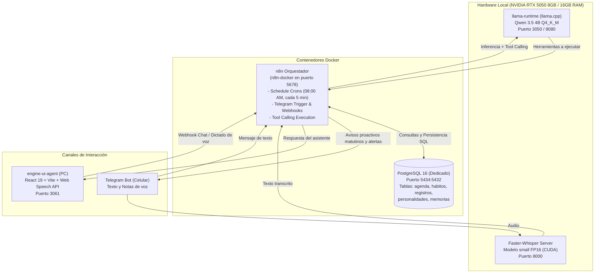
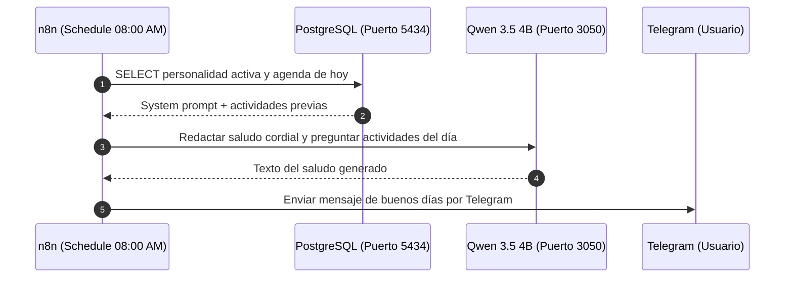
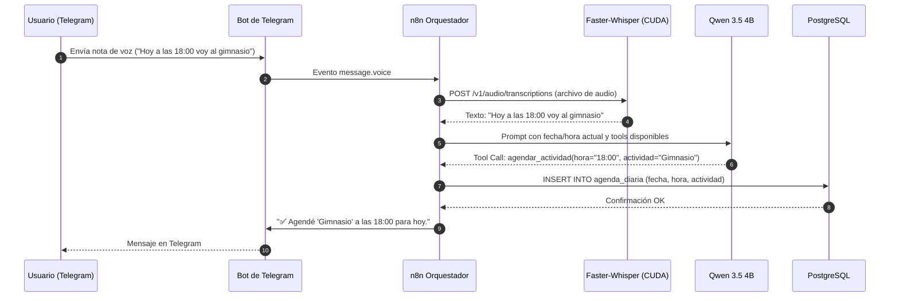
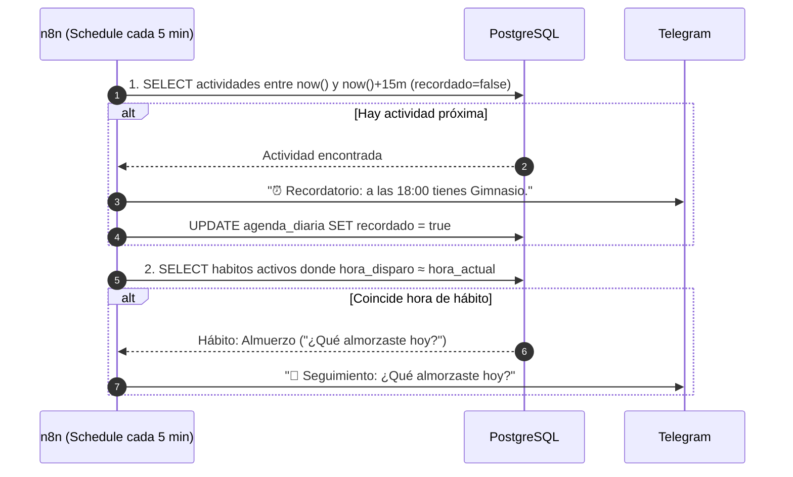

# Arquitectura de la Solución — llama-engine-agent

## 1. Diagrama General de Componentes

---

## 2. Flujo de Secuencia: Disparador Matutino (Buenos Días)

---

## 3. Flujo de Secuencia: Mensaje de Voz y Agendamiento

---

## 4. Flujo de Secuencia: Reloj Vigilante (Recordatorios y Hábitos)

