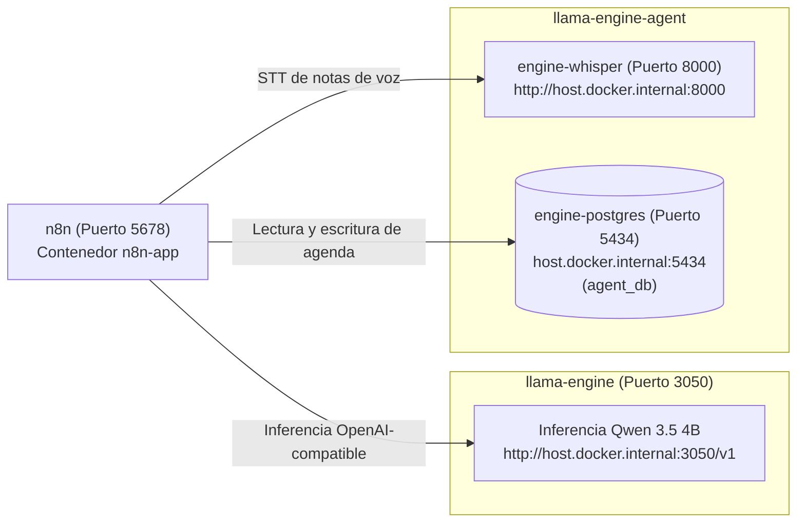

# engine-n8n — Guía de Orquestación y Conexión

Este módulo documenta la integración de **n8n** como orquestador proactivo para el ecosistema de **`llama-engine-agent`**, conectado al runtime de inferencia **`llama-engine`**, al servicio de transcripción **`engine-whisper`** y a la base de datos persistente **`engine-postgres`**.

---

## 🧭 Mapa de Conexión entre Servicios

Cuando n8n se ejecuta en su propio stack de contenedores Docker, se comunica con los servicios del host y del agente mediante la dirección de puente de Docker Desktop: **`host.docker.internal`**.

---

## 🤖 1. Configuración del Modelo LLM (Connect a model)

Para conectar el **AI Assistant** y los nodos LLM de n8n a tu runtime local `llama-engine`, ingresa los siguientes valores en la ventana **Connect a model**:

| Campo | Valor exacto | Descripción |
|---|---|---|
| **Provider** | `Self-hosted or OpenAI-compatible endpoint` | Compatible con la API OpenAI expuesta por `engine-api` |
| **Base URL** | `http://host.docker.internal:3050/v1` | Endpoint del wrapper de `llama-engine` |
| **API key** | `llama-engine-dev` | Clave definida en `llama-engine/.env` |
| **Model** | `qwen3.5-4b` | Nombre del modelo activo en el runtime |

> [!TIP]
> **¿Por qué `host.docker.internal:3050`?**  
> `localhost` dentro del contenedor de n8n apunta a n8n mismo. Usar `host.docker.internal` permite salir del contenedor y acceder al puerto `3050` publicado en tu máquina física donde corre `llama-engine`.

---

## 🐘 2. Conexión a la Base de Datos del Agente (`engine-postgres`)

El asistente almacena su agenda, personalidades y hábitos en `engine-postgres` (independiente de la base de datos interna de n8n):

| Campo | Valor exacto |
|---|---|
| **Credential Type** | Postgres account |
| **Host** | `host.docker.internal` |
| **Port** | `5434` *(puerto externo expuesto en tu host)* |
| **Database** | `agent_db` |
| **User** | `agent_user` |
| **Password** | `agent_secret_password` |
| **SSL** | Desactivado (o marcar *Ignore SSL Issues*) |

> [!NOTE]
> La base de datos interna de n8n corre en el puerto `5433` (`n8n-postgres`). La base de datos del agente corre en el puerto `5434` (`engine-postgres`), conteniendo las tablas `agenda_diaria`, `habitos_config`, `registro_habitos`, `personalidades` y `memorias`.

---

## 🎙️ 3. Conexión a Transcripción de Audio (`engine-whisper`)

Para transcribir notas de voz de Telegram o de la UI web dentro de los workflows de n8n:

* **Método HTTP:** `POST`
* **URL:** `http://host.docker.internal:8000/v1/audio/transcriptions`
* **Content-Type:** `multipart/form-data`
* **Campos del body:**
  - `file`: Archivo binario de audio (`.ogg`, `.mp3`, `.wav`)
  - `model`: `Systran/faster-whisper-small` (o `whisper-1`)

---

## 🛡️ 4. Configuración del Code Sandbox en n8n

Para que el AI Assistant y los Agentes ejecuten código Python/JavaScript de forma aislada sin comprometer tu máquina:

* **Opción:** Seleccionar **n8n Sandbox**.
* **Service URL:** `http://sandbox-api:8080` *(si corre en la misma red de n8n)* o `http://host.docker.internal:3200` *(si se consulta por el puerto del host)*.
* **API key:** El token definido en la variable `SANDBOX_API_KEY` (por ejemplo `n8n_sandbox_secret_key_2026`).

---

## 📋 5. Workflows Disponibles (`workflows/`)

En la carpeta [`workflows/`](./workflows/) se encuentran los 4 flujos listos para importar:

1. **`01_saludo_matutino.json`**:
   - **Disparador:** 08:00 AM diario.
   - **Acción:** Lee actividades y personalidad activa en PostgreSQL, redacta saludo personalizado con Qwen 3.5 4B y lo envía a Telegram.
2. **`02_cerebro_conversacional.json`**:
   - **Disparador:** Mensajes entrantes de Telegram (texto o notas de voz).
   - **Acción:** Transcribe con Whisper si es voz, razona con Qwen 3.5 4B, invoca tools (`agendar_actividad`, `consultar_agenda`, `crear_habito`, `registrar_habito`) y responde por Telegram.
3. **`03_reloj_vigilante.json`**:
   - **Disparador:** Cada 5 minutos.
   - **Acción:** Vigila actividades programadas con 15 minutos de anticipación y dispara recordatorios de hábitos según horarios configurados.
4. **`04_api_webhook_web_ui.json`**:
   - **Endpoints:**
     - `POST /webhook/agent-chat`: Para chatear desde la UI web (`http://localhost:3061`).
     - `GET /webhook/agent-agenda`: Para alimentar el dashboard de actividades del día.

### Cómo importarlos en n8n:
1. En la barra lateral de n8n, ve a **Workflows**.
2. Haz clic en **Add workflow** (o botón `+`).
3. En la esquina superior derecha del lienzo, abre el menú de tres puntos (`...`) y selecciona **Import from File**.
4. Selecciona el archivo `.json` correspondiente desde la carpeta `engine-n8n/workflows/`.
5. Asigna las credenciales configuradas en los pasos 1 y 2 a los nodos de Postgres y OpenAI.
